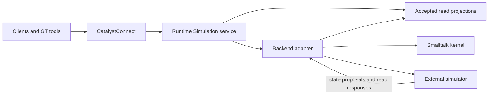

# Catalyst Simulator

Catalyst Simulator is the home of the GemStone-first CatalystSimulation kernel,
its Runtime service, portable model contracts and future external execution
adapters. P0/P1 now includes a headless portable graph interpreter, versioned
operation registry, model digests and compatibility checks, qualified in GT and
GemStone. The P2 Repast adapter passes native macOS feasibility, and the P3 Runtime
service now provides accepted revisions, placement fencing and GemStone recovery.
The live native batch and resident adapters connect Runtime to Repast and query
durable receipts across restarts. Resident ranks retain graphs and agents between
accepted windows. The optional sharded mode publishes accepted roots and bounded
projection pages, reusing unchanged checkpoint/projection objects. A GT placement
action and production population benchmarks remain later gates.

The [`typed-1` profile](contracts/typed-1/README.md) adds packed Smalltalk population
columns and fixed-width native records, with shard-based local reconstruction.
See [typed population qualification](conformance/Typed-Population.md) for the
100,000-entity workload, rank-count and Runtime durability evidence. Legacy profiles
keep their existing limits; admission capacity is separate from tested workload
capacity.

Ecosystems are the first domain; NPCs and automation remain deferred. The
intended workflow is to author a model once in Smalltalk, run it entirely in
GemStone or GT, then move the same supported model to a configured external
backend through one GT action. Repast HPC is the first distributed feasibility
target.

## Simulator and ecosystem split

| Component | Responsibility |
| --- | --- |
| CatalystSimulation kernel | Shared execution, state, Runtime service and external backend contracts |
| CatalystSimulatorPlugin | Shared UE simulation feature set, data/cache/lifecycle management, Mass/instance adapters, interpolation and representation budgets |
| CatalystEcosystem | Actual ecosystem behaviour, species/habitat definitions and ecological rules over the kernel |
| CatalystEcosystemPlugin | Ecosystem presentation: meshes, textures, materials, animation, appearance variants and ecosystem-specific visual/interaction policy |

The ecosystem UE plugin depends on the Simulator UE plugin. It supplies domain
presentation providers and content; the Simulator plugin manages the common data
and rendering mechanisms. See [component boundaries](docs/Component-Boundaries.md)
for the provider contract and acceptance checks.

## Runtime remains the client endpoint

The [sharded checkpoint and projection qualification](conformance/Sharded-Projections.md)
records Runtime-owned GemStone → Repast → GemStone switching and recovery on
1/2/4 native macOS ranks, including a 4,096-entity checkpoint above the old
whole-state transport limit. Select `repastMode: 'sharded'` for the
[`checkpoint-1`](contracts/checkpoint-1/README.md) and
[`projection-1`](contracts/projection-1/README.md) contracts. The existing graph
capacity and local materialization limits remain for the legacy profiles. The
subsequent typed profile has its own population and switching qualification.

Clients always use the Simulation service hosted by CatalystRuntime through
CatalystConnect. Selecting an external simulator changes execution placement;
it does not change the client API, endpoint or simulation identity.

The Simulation service owns authorization, command outcomes, accepted revisions,
client observations and execution migration. A backend adapter supplies model
execution, resumable checkpoints and a common read interface:

- Frequent client/AOI updates use bounded accepted snapshots and deltas maintained
  by the service. Large external populations stay resident in the simulator.
- On-demand entity, region, behaviour, circuit and factory queries go through the
  adapter against an identified accepted read view. No per-creature RPC is needed
  for ordinary simulation progression or client streaming.
- Results identify their world, execution group, model digest, placement generation,
  accepted revision and logical frontier. The service validates them before serving
  clients; speculative states and obsolete-session replies are excluded.
- Read-view expiry, backend unavailability and stale observations are explicit.
  Gaps trigger resnapshot; slow consumers retain bounded state.
- Switching backends preserves subscriptions and the client service identity. Reads
  during handover use the last accepted view or report temporary unavailability.

GemStone remains the default durable acceptance authority when execution is
external. Runtime does not need to mirror every external agent as a live Smalltalk
object; it needs recoverable accepted state and the projections required by clients.
GT-local worlds can use the same contracts with an explicitly volatile authority.

## Implementation

The bounded [`graph-1` contract](contracts/graph-1/README.md) adds typed value/effect
nodes, staged reads, deterministic scheduling, 16 versioned primitives, SHA-256
model identity and node-specific capability reports. A Smalltalk builder produces
immutable data that the backend interprets, with pre-launch operation and retained
value budgets. The original [`probe-1` contract](contracts/probe-1/README.md) and
its checkpoint bytes remain supported.

Three neutral models and their model digests, state traces and compatibility
fixtures match in GT and native GemStone. The same bundles now run through
[native Repast HPC](native/p2/README.md) with byte-identical 1/2/4-rank results,
actual agent migration and cross-rank resource contention. All 24 tested external
checkpoints round-trip through the dedicated `bvc_simulator_native` stone and
continue identically. Full P0/P1 gates and one-click migration remain open.

The [authority-1 contract](contracts/authority-1/README.md) implements the stable
Runtime endpoint for both placements. It accepts bounded canonical WorkUnits,
atomically records revisions/checkpoints/outcomes, fences obsolete placements,
preserves uncertain external batches and exposes accepted reads and retry receipts.
The [P3 qualification](conformance/P3-Runtime.md) covers 52 GT tests, 43 native
portable tests, managed Runtime routing/restarts/rollback, real two-session write
conflicts and return of the actual P2 Repast checkpoint through the service.
The [live Repast integration](conformance/Live-Repast.md) adds Runtime-owned
native launches, paused restore validation, result acceptance and recovery of a
lost reply. Client reads continue through the same named Simulation service.
The [resident backend](conformance/Resident-Repast.md) retains one MPI incarnation
across consecutive advances and Runtime restarts, requires acceptance acknowledgment,
and fences launch/retirement effects by placement generation. Its
[`resident-1` contract](contracts/resident-1/README.md) preserves the same portable
models and GemStone switch/recovery operations.

Core loads without Runtime, GT UI or ecosystem dependencies. Load Metacello
baseline `CatalystSimulator` from this repository's `src`, group `Core` (default),
`Authority`, `Runtime`, `Tests` or `RuntimeTests`. Core and Authority remain
independent of Runtime. `Tests` covers the portable kernel/authority, while
`RuntimeTests` adds Runtime integration. Rowan specifications are also supplied.
See [qualification and usage](conformance/README.md) for the SUnit suite, native
runner, inspectable models and independent Python fixture oracles. The
[rebuild record](docs/Rebuild-Readiness.md) records the passing fresh GT/devkit
checks. Current GemStone 3.7 development uses `--with-seaside`; Rowan is deferred
until the later GemStone 4 migration.

The [prototype mining ledger](docs/Prototype-Mining-Ledger.md) records what was
adapted and deferred. All shared Smalltalk source is compiled and exported through
the live GT image; exported files must not be edited externally.

## Layout

| Area | Responsibility |
| --- | --- |
| `src/` | Portable kernel, acceptance authority, Runtime service/WorkUnits and optional tests; sources authored/exported through GT |
| `contracts/` | Probe, graph and authority model/state/numeric/capability/service/recovery contracts |
| `native/` | Shared C++ operations/codecs and external adapters, starting with a Repast feasibility probe |
| `conformance/` | GT, native GemStone, external-backend, migration and scale evidence |

The `native/p2/` adapter is a bounded feasibility implementation, with its
toolchain and qualification evidence recorded in the component. The workspace checkout is
`Simulation/catalyst-simulator`. Upstream source references live in the workspace's
`Simulation/References/`, separately from this component's dependencies.

The shared UE binding has its own registered repository at
`Simulation/catalyst-simulator-ue-plugin`. Ecosystem behaviour and presentation
live separately at `Ecosystems/catalyst-ecosystem` and
`Ecosystems/catalyst-ecosystem-ue-plugin`. The kernel repository does not contain
those UE plugins or production ecosystem rules.

Existing live GT `CESim*` code is experimental mining input. The
[GT inventory](https://github.com/BenjaVisionPro/catalyst-workspace/blob/main/Simulation/GT-Prototype-Mining-Inventory.md)
records useful candidates and concrete gaps; source recovery must go through GT
MCP before any adoption into these repositories.

## Design and implementation

The workspace contains the
[design reference](https://github.com/BenjaVisionPro/catalyst-workspace/blob/main/Simulation/Catalyst-Simulation-Design-Reference.md)
and [implementation plan](https://github.com/BenjaVisionPro/catalyst-workspace/blob/main/Simulation/Catalyst-Simulation-Implementation-Plan.md).
The plan defines the native kernel, the ecosystem slice, deferred NPC/automation work,
early Repast round-trip test, Runtime read integration and one-click migration.

The [UE projection research](https://github.com/BenjaVisionPro/catalyst-workspace/blob/main/Simulation/UE-Projection-Research-and-Design.md)
recommends a Mass-based hybrid presentation layer and compares instanced skinned
meshes, ISM/VAT and pooled Actors for desktop/console. The
[source review](docs/ue-projection-source-review.json) records the inspected UE
5.8.4 build and API/descriptor files; it is not runtime or performance qualification.

## License

[MIT](LICENSE). Upstream source references and dependencies retain their own licences.
