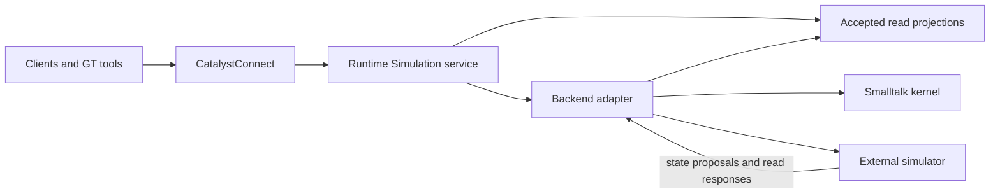

# Catalyst Simulator

Catalyst Simulator is the home of the GemStone-first CatalystSimulation kernel,
its Runtime service, portable model contracts and future external execution
adapters. The repository currently contains project documentation; the kernel
and adapters are planned.

Models cover ecosystems, NPC behaviour, circuits and factory automation. The
intended workflow is to author a model once in Smalltalk, run it entirely in
GemStone or GT, then move the same supported model to a configured external
backend through one GT action. Repast HPC is the first distributed feasibility
target.

## Runtime remains the client endpoint

Clients always use the Simulation service hosted by CatalystRuntime through
CatalystConnect. Selecting an external simulator changes execution placement;
it does not change the client API, endpoint or simulation identity.

The Simulation service owns authorization, command outcomes, accepted revisions,
client observations and execution migration. A backend adapter supplies model
execution, resumable checkpoints and a common read interface:

- Frequent client/AOI updates use bounded accepted snapshots and deltas maintained
  by the service. Large external populations stay resident in the simulator.
- On-demand entity, region, behaviour, circuit and factory queries go through the
  adapter against an identified accepted read view. No per-creature RPC is needed
  for ordinary simulation progression or client streaming.
- Results identify their world, execution group, model digest, placement generation,
  accepted revision and logical frontier. The service validates them before serving
  clients; speculative states and obsolete-session replies are excluded.
- Read-view expiry, backend unavailability and stale observations are explicit.
  Gaps trigger resnapshot; slow consumers retain bounded state.
- Switching backends preserves subscriptions and the client service identity. Reads
  during handover use the last accepted view or report temporary unavailability.

GemStone remains the default durable acceptance authority when execution is
external. Runtime does not need to mirror every external agent as a live Smalltalk
object; it needs recoverable accepted state and the projections required by clients.
GT-local worlds can use the same contracts with an explicitly volatile authority.

## Planned layout

| Area | Responsibility |
| --- | --- |
| `src/` | Portable Smalltalk kernel, domain model packages, Runtime/GemStone integration and GT tooling; sources authored/exported through GT |
| `contracts/` | Versioned model, state, backend and read protocols plus canonical fixtures |
| `native/` | Shared C++ operations/codecs and external adapters, starting with a Repast feasibility probe |
| `unreal/` | Planned compact accepted-state projection, optional Mass adapters and representation/animation qualification |
| `conformance/` | GT, native GemStone, external-backend, migration and scale evidence |

These are planned directories, not implemented packages. The workspace checkout is
`Simulation/catalyst-simulator`. Upstream source references live in the workspace's
`Simulation/References/`, separately from this component's dependencies.

## Design and implementation

The workspace contains the
[design reference](https://github.com/BenjaVisionPro/catalyst-workspace/blob/main/Simulation/Catalyst-Simulation-Design-Reference.md)
and [implementation plan](https://github.com/BenjaVisionPro/catalyst-workspace/blob/main/Simulation/Catalyst-Simulation-Implementation-Plan.md).
The plan defines the native kernel, ecosystem/NPC/automation vertical slices,
early Repast round-trip test, Runtime read integration and one-click migration.

The [UE projection research](https://github.com/BenjaVisionPro/catalyst-workspace/blob/main/Simulation/UE-Projection-Research-and-Design.md)
recommends a Mass-based hybrid presentation layer and compares instanced skinned
meshes, ISM/VAT and pooled Actors for desktop/console. The
[source review](docs/ue-projection-source-review.json) records the inspected UE
5.8.4 build and API/descriptor files; it is not runtime or performance qualification.

## License

[MIT](LICENSE). Upstream source references and dependencies retain their own licences.
