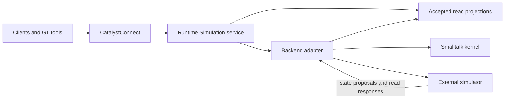

# Catalyst Simulator

Catalyst Simulator is the home of the GemStone-first CatalystSimulation kernel,
its Runtime service, portable model contracts and future external execution
adapters. The first P0/P1 increment implements a headless portable kernel probe
in GT and GemStone. Runtime service integration and external adapters remain
planned.

Models cover ecosystems, NPC behaviour, circuits and factory automation. The
intended workflow is to author a model once in Smalltalk, run it entirely in
GemStone or GT, then move the same supported model to a configured external
backend through one GT action. Repast HPC is the first distributed feasibility
target.

## Simulator and ecosystem split

| Component | Responsibility |
| --- | --- |
| CatalystSimulation kernel | Shared execution, state, Runtime service and external backend contracts |
| CatalystSimulatorPlugin | Shared UE simulation feature set, data/cache/lifecycle management, Mass/instance adapters, interpolation and representation budgets |
| CatalystEcosystem | Actual ecosystem behaviour, species/habitat definitions and ecological rules over the kernel |
| CatalystEcosystemPlugin | Ecosystem presentation: meshes, textures, materials, animation, appearance variants and ecosystem-specific visual/interaction policy |

The ecosystem UE plugin depends on the Simulator UE plugin. It supplies domain
presentation providers and content; the Simulator plugin manages the common data
and rendering mechanisms. See [component boundaries](docs/Component-Boundaries.md)
for the provider contract and acceptance checks.

## Runtime remains the client endpoint

Clients always use the Simulation service hosted by CatalystRuntime through
CatalystConnect. Selecting an external simulator changes execution placement;
it does not change the client API, endpoint or simulation identity.

The Simulation service owns authorization, command outcomes, accepted revisions,
client observations and execution migration. A backend adapter supplies model
execution, resumable checkpoints and a common read interface:

- Frequent client/AOI updates use bounded accepted snapshots and deltas maintained
  by the service. Large external populations stay resident in the simulator.
- On-demand entity, region, behaviour, circuit and factory queries go through the
  adapter against an identified accepted read view. No per-creature RPC is needed
  for ordinary simulation progression or client streaming.
- Results identify their world, execution group, model digest, placement generation,
  accepted revision and logical frontier. The service validates them before serving
  clients; speculative states and obsolete-session replies are excluded.
- Read-view expiry, backend unavailability and stale observations are explicit.
  Gaps trigger resnapshot; slow consumers retain bounded state.
- Switching backends preserves subscriptions and the client service identity. Reads
  during handover use the last accepted view or report temporary unavailability.

GemStone remains the default durable acceptance authority when execution is
external. Runtime does not need to mirror every external agent as a live Smalltalk
object; it needs recoverable accepted state and the projections required by clients.
GT-local worlds can use the same contracts with an explicitly volatile authority.

## Implementation

The bounded [`probe-1` contract](contracts/probe-1/README.md) covers fixed-step
integer movement, deterministic finite-resource contention, cancellable timers,
mode changes, addressed Philox randomness and canonical checkpoints. It is the
starting conformance target for a future Repast adapter. It does not close the
full P0/P1 gates or provide one-click external execution yet.

Core loads without Runtime, GT UI or ecosystem dependencies. Load Metacello
baseline `CatalystSimulator` from this repository's `src`, group `Core` (default)
or optional group `Tests`. Rowan Core/Tests specifications are also supplied.
See [qualification and usage](conformance/README.md) for the SUnit suite, native
runner, inspectable probe and independent Python fixture oracle.

The [prototype mining ledger](docs/Prototype-Mining-Ledger.md) records what was
adapted and deferred. All shared Smalltalk source is compiled and exported through
the live GT image; exported files must not be edited externally.

## Layout

| Area | Responsibility |
| --- | --- |
| `src/` | Implemented headless portable probe and optional tests; Runtime adapters/GT tools follow; sources authored/exported through GT |
| `contracts/` | Implemented probe model/state/numeric contract and canonical fixtures; service/read/migration protocols follow |
| `native/` | Shared C++ operations/codecs and external adapters, starting with a Repast feasibility probe |
| `conformance/` | GT, native GemStone, external-backend, migration and scale evidence |

The `native/` adapter area remains planned. The workspace checkout is
`Simulation/catalyst-simulator`. Upstream source references live in the workspace's
`Simulation/References/`, separately from this component's dependencies.

The shared UE binding has its own registered repository at
`Simulation/catalyst-simulator-ue-plugin`. Ecosystem behaviour and presentation
live separately at `Ecosystems/catalyst-ecosystem` and
`Ecosystems/catalyst-ecosystem-ue-plugin`. The kernel repository does not contain
those UE plugins or production ecosystem rules.

Existing live GT `CESim*` code is experimental mining input. The
[GT inventory](https://github.com/BenjaVisionPro/catalyst-workspace/blob/main/Simulation/GT-Prototype-Mining-Inventory.md)
records useful candidates and concrete gaps; source recovery must go through GT
MCP before any adoption into these repositories.

## Design and implementation

The workspace contains the
[design reference](https://github.com/BenjaVisionPro/catalyst-workspace/blob/main/Simulation/Catalyst-Simulation-Design-Reference.md)
and [implementation plan](https://github.com/BenjaVisionPro/catalyst-workspace/blob/main/Simulation/Catalyst-Simulation-Implementation-Plan.md).
The plan defines the native kernel, ecosystem/NPC/automation vertical slices,
early Repast round-trip test, Runtime read integration and one-click migration.

The [UE projection research](https://github.com/BenjaVisionPro/catalyst-workspace/blob/main/Simulation/UE-Projection-Research-and-Design.md)
recommends a Mass-based hybrid presentation layer and compares instanced skinned
meshes, ISM/VAT and pooled Actors for desktop/console. The
[source review](docs/ue-projection-source-review.json) records the inspected UE
5.8.4 build and API/descriptor files; it is not runtime or performance qualification.

## License

[MIT](LICENSE). Upstream source references and dependencies retain their own licences.
