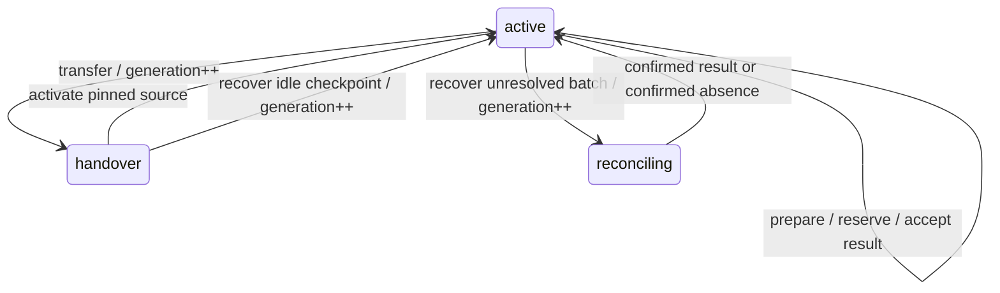

# Simulation authority-1

P3 provides a named Runtime Simulation service over the existing portable graph
and checkpoint contracts. Runtime is the application endpoint for both Smalltalk
and external execution. Ecosystem, NPC and automation behaviour remain separate
model providers; this package adds no domain behaviour or UE presentation policy.

## Packages and ownership

| Package | Responsibility |
| --- | --- |
| `BVC-Simulator-Core` | Unchanged portable model interpreter and checkpoint codec |
| `BVC-Simulator-Authority` | Persistent catalogues, accepted groups, receipts, placement and reconciliation; no Runtime dependency |
| `BVC-Simulator-Runtime` | Named service, described configuration, narrow capability, inert requests, scheduled coordinator and committed result completion |
| `BVC-Simulator-Tests-Authority` | Portable acceptance/fencing/recovery tests |
| `BVC-Simulator-Tests-Runtime` | GT worker examples and native qualification fixtures |

Metacello's default remains `Core`. Select `Authority`, `Runtime`, `Tests` or
`RuntimeTests` explicitly. `Tests` covers the kernel and authority without Runtime;
`RuntimeTests` adds Runtime integration and its test support. Rowan metadata is
provided for later use; the current GemStone 3.7 devkit loads through the
`--with-seaside` recipes.

`CSSimulationRepository` has named catalogues. Each execution group is one
`CSExecutionGroup` with a private state dictionary. Its checkpoint is canonical
data, with no live backend, worker, capability, closure, process or socket.
Services, caches, progress schedules and publishers are activation-local.

Each mutation constructs a candidate and replaces the group's state slot once.
That slot is the ordinary GemStone optimistic write guard. Two sessions accepting
from the same revision conflict even if their proposed entity writes would
otherwise be disjoint. Catalogue creation has its own ordinary dictionary write
boundary. No local mutex stands in for repository ownership.

GT uses the same authority code with volatile in-memory storage. GemStone
durability comes from Runtime's existing transaction owner, native delivery queue,
nested body rollback and outer body/acknowledgement/evidence commit.

## Named service and principals

Configure a `CSSimulationConfiguration` with `serviceClass = CSSimulationService`,
a unique service identifier, `authoritative = true`, and a repository name.
Use Runtime's existing service bindings to name this endpoint from consumers.
Ordinary service configuration replacement never changes the group's placement;
placement changes use the operations below.

Configuration describes these bounded settings:

| Setting | Default | Bounds/purpose |
| --- | --- | --- |
| `repositoryName` | `simulations` | Nonempty printable text, at most 128 characters |
| `controlPrincipal` | `simulation-admin` | Trusted world/controller identity |
| `executorPrincipal` | `simulation-executor` | Trusted external result producer; distinct from controller |
| `maximumGroups` | 16 | 1–128 |
| `journalLimit` | 16 | 1–64 receipts per group |
| `maximumSteps` | 8 | 1–64 logical ticks per request |
| `driveThroughTick` | 0 | 0 disables scheduled local progression |
| `driveIntervalMillis` | 1000 | 10–60,000; a wakeup interval, not simulation time |

The trusted ingress constructs WorkUnits and supplies the authenticated principal
separately from client data. The principal names are roles, not credentials.
This service does not authenticate a transport peer. Do not decode arbitrary
Smalltalk objects or trust a client-supplied principal. A Connect wire/object
binding and its authentication mapping are separate integration work.

Controllers create worlds, submit commands, advance locally, prepare batches,
transfer placements and reconcile recovery. Executors reserve dispatch and submit
results. Both can read accepted views, outcome receipts and recovery status.
The service rejects stopped/obsolete capabilities, non-authoritative instances
and wrong principals. Application WorkUnits receive only `CSSimulationCapability`,
with no Runtime control, raw worker or queue grant.

## Mutation envelope

Every mutation has exactly these canonical dictionary fields:

| Field | Meaning |
| --- | --- |
| `world`, `group` | Stable 32-digit lowercase hexadecimal identities |
| `sequence` | Next positive signed-64-bit sequence for this group |
| `id` | Nonempty printable request label, at most 128 characters |
| `expectedRevision` | The accepted revision on which the operation is based |
| `generation`, `owner` | Current placement generation and 128-bit owner token |
| `payload` | Operation-specific canonical data |

Requests are captured as canonical bytes when a WorkUnit is constructed, with a
256 KiB maximum. Caller mutation of the original dictionaries cannot change queued
work. No mutation WorkUnit permits automatic conflict replay.

The initial create uses sequence 1, expected revision 0, generation 0 and an empty
owner field. Its payload contains a validated graph checkpoint, backend kind,
new owner token and supported operation names. It accepts revision 1/generation 1.
The owner is a placement identity/fence, not an authentication secret.

A group retains its sequence high-water mark permanently. A retry uses the
**same sequence, label, principal and complete request bytes**. Within retention,
the fingerprint must match and the original receipt is returned without mutation.
Changing the payload or principal under that sequence is rejected. Evicted
sequences are explicitly expired and can never execute again. A future sequence
gap is rejected. The request label alone is not the idempotency key.

Receipt queries distinguish `accepted`, `expired` and `unknown`. An uncertain
client checks the receipt and current committed frontier before deciding what
to do; it must not allocate a new sequence merely to retry an uncertain command.
Rejected bodies do not consume a group sequence or create an accepted receipt.

## Accepted state and operations

Accepted revision advances on every accepted authority operation, including a
placement or batch-state change at the same logical tick. Logical time comes
from the checkpoint, never wall-clock scheduling.

| WorkUnit | Operation |
| --- | --- |
| `CSCreateSimulationWorkUnit` | Create a graph world/group under the configured catalogue limits |
| `CSCommandSimulationWorkUnit` | Apply a bounded array of portable `request`, `schedule` or `cancel` commands at the accepted boundary |
| `CSAdvanceSimulationWorkUnit` | Restore the accepted checkpoint, advance a bounded local batch and accept its state/time/outcomes atomically |
| `CSPrepareSimulationBatchWorkUnit` | Persist one external batch bound to the exact input revision, model/state, owner, generation and target tick |
| `CSDispatchSimulationBatchWorkUnit` | Reserve external delivery by changing prepared to uncertain **before I/O** |
| `CSAcceptSimulationResultWorkUnit` | Accept a result for the reserved current batch |
| `CSMigrateSimulationWorkUnit` | Preflight operations, increment generation, fence the old owner and enter handover |
| `CSActivateSimulationPlacementWorkUnit` | Verify the pinned source checkpoint/model digests and activate the new placement |
| `CSRecoverSimulationWorkUnit` | Rotate owner/generation from fresh committed state; preserve an unresolved external batch |
| `CSReconcileSimulationWorkUnit` | Explicitly accept a confirmed queried result or record confirmed absence with bounded review proof |

Command arrays contain 1–64 entries and at most 8 KiB. Checkpoints are bounded to
192 KiB in this initial authority profile. The checkpoint's original graph-1
numeric, schema, capacity, reference and model-digest checks still apply.

There is at most one pending external batch per group. It blocks commands,
another batch and placement transfer until resolved. Its content-derived identity
and input digest include the source world/group, revision, placement, checkpoint
digest and target. Result acceptance checks that identity, current placement,
model, seed and exact target tick. It trusts an authorized qualified executor for
simulation semantics; it does not repeat the external simulation in GemStone.

Accepted checkpoint, logical time, revision, input fingerprint, outcome receipt
and batch/placement transition are in the same group candidate and Runtime commit.
The journal retains compact input metadata and portable command data; imported
checkpoint payloads are represented there by their digest. It is a bounded audit
and retry window, not an unlimited event-sourcing log.

## Placement and recovery

Transfer preflight occurs before any accepted change. Unsupported operation sets
leave placement and revision intact. Handover preserves the checkpoint; old
placement work cannot advance the new generation. Activation validates the source
digests. Starting a remote process and establishing its authenticated readiness
belongs to the external adapter; the controller calls activation after that work.

Recovery plans classify committed state as:

| Action | Required next step |
| --- | --- |
| `resume-frontier` | Reconstruct local execution from the accepted checkpoint |
| `validate-placement` | Complete or explicitly recover a recorded handover |
| `reserve-dispatch` | Reserve the prepared outgoing batch durably before sending |
| `query-result` | Query the executor by stable batch/input identity; never blindly resend |
| `review-fenced-batch` | Reconcile a retained batch from an obsolete placement under controller authority |

Plans always report `automaticReplay = false`. Restart does not delete pending
evidence. Recovering an uncertain batch changes the placement fence while retaining
the original batch stamp, so a late old-owner result cannot directly commit.
A controller may reconcile a confirmed queried checkpoint, or declare confirmed
absence with review proof. Unknown outcomes remain unresolved and block progression.
The service does not implement executor querying itself or assert exactly-once I/O.

Runtime's existing unresolved delivery/commit evidence remains authoritative.
These operations do not clear native queue claims, restart unconfirmed failed
workers or replay saved envelopes. Resolve those through Runtime's normal lifecycle
and inspection controls before resuming application work.

## Reads and committed publication

`CSReadSimulationWorkUnit` and `CSCheckpointSimulationWorkUnit` use the same
endpoint for both placements. Query dictionaries contain exactly `world`,
`group`, `minimumRevision` and `argument`. Views identify schema version, world,
group, model digest, accepted revision, logical checkpoint, checkpoint digest,
placement generation/owner, backend, phase, sequence high-water and retry floor.
They also expose bounded pending/placement metadata.

`CSQuerySimulationOutcomeWorkUnit` takes a sequence argument;
`CSReadSimulationChangesWorkUnit` takes the last observed accepted revision.
The latter returns a bounded receipt journal and a resnapshot flag when history
has expired. There are no unbounded per-consumer queues or retained acknowledgements.
`CSInspectSimulationRecoveryWorkUnit` returns the recovery plan.

Reads run through Runtime-owned transactions on GemStone and enforce the minimum
revision. Query results are copied canonical values. `CSSimulationCommittedCompletion`
opts in to Runtime's after-commit and after-finalization publication and releases
its activation-local publisher afterward. A lost or failed callback does not
replay the application body; the client can query the accepted receipt/view.
Commit failure cannot publish a success result through this completion.

This bounded P3 profile serves full accepted checkpoint views from GemStone.
P6/P8 must add accepted external read handles, partitioned durable state and bounded
AOI/detail projections for large populations. Clients will continue using the same
Runtime service identity; they will not connect directly to Repast.

## Scheduled progression and lifecycle

`CSSimulationDriveWork` is a nontransactional, activation-local progress command.
It reads committed groups and submits inert `CSScheduledSimulationAdvanceWorkUnit`
requests through `CRRoutingCapability`, explicitly addressed to the owning worker
and named Simulation service. No repository simulation mutation occurs in the
progress command. The native worker executes the submitted request inside its
normal owned transaction. This existing same-worker route required no Runtime
source change.

The coordinator coalesces each queued frontier in a bounded activation-local map.
A failed frontier is not repeatedly enqueued during that activation. A fresh
activation rebuilds from committed state. Scheduled requests carry a configuration
policy digest, preventing old queued progression from ignoring a changed drive
limit. `maximumSteps` bounds work per transaction; wall-clock wakeups never enter
model identity or checkpoint time.

Stop deactivates/removes owned schedules and expires service capabilities. Native
Runtime drains/records its deliveries and owns process cleanup. Persistent groups
and unresolved batches survive service/Runtime restarts. Ordinary reconfiguration
does not migrate a backend or resize a persistent catalogue's creation policy.

## Qualification and limits

See [P3 results](../../conformance/results/runtime-p3-2026-10-30/qualification.json)
and [reproduction](../../conformance/P3-Runtime.md).
The record covers 52 GT tests, 43 native portable tests and a configured native
Runtime with real named routing, independent-session reads/rollback, scheduled
progression, restarts, external-result reconciliation, local return, expired
retries and two conflicting writer rounds. Each loser executes once and fails its
outer commit with a real write/write conflict.

The external result is the actual pinned P2 four-rank Repast checkpoint, consumed
through the P3 Runtime path. P3 launches no external process. Native callback
infrastructure has its existing Runtime qualification; this change adds GT tests
for Simulation completion/finalization and native committed reads through the
managed service.

This does not qualify a Connect transport binding, a remote executor lifecycle,
a killed stone/WAL recovery, multi-host execution, 100,000 creatures or the
one-click UI. Those remain explicit subsequent gates. The kernel and model bytes
remain portable and the Simulator/Ecosystem split is unchanged.
