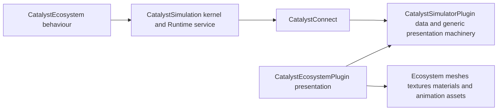

# Simulator and ecosystem component boundaries

30 October 2026. Agreed design boundary; implementation remains planned.

CatalystSimulatorPlugin provides the shared UE simulation feature set and manages
projected simulation data. CatalystEcosystem provides ecosystem behaviour over the
CatalystSimulation kernel. CatalystEcosystemPlugin provides ecosystem-specific
presentation, including every choice of meshes, textures, materials and animation.

## Responsibilities

| Component | Owns |
| --- | --- |
| CatalystSimulation kernel in `catalyst-simulator` | Logical time, scheduling, generic operations, state/identity, partition ownership, checkpoint/replay, Runtime service and external backend/read contracts |
| CatalystSimulatorPlugin in UE | Shared simulation APIs and connection binding, subscriptions/queries/commands, accepted data cache, identity/revision management, interpolation, Mass/instance adapters, Actor pools and global presentation budgets |
| CatalystEcosystem | Species and habitat definitions, resource/ecological rules, predation, reproduction, disease and ecosystem model composition; portable domain schemas and semantic state |
| CatalystEcosystemPlugin in UE | Ecosystem views and presentation mappings; species/variant meshes, textures/materials, skeletons, animations, appearance changes, ecosystem visual LOD choices, foliage/weather integration and ecosystem interaction UI |

Runtime remains the client-facing service for both local and external execution.
The Simulator plugin consumes that service through CatalystConnect and manages
its UE-world data lifetime. An ecosystem plugin consumes the Simulator plugin's
APIs instead of creating a second network session, entity cache or simulation clock.

## Dependency direction

The Simulator kernel/plugin has no production dependency on CatalystEcosystem or
CatalystEcosystemPlugin. A project that presents another simulation can load the
Simulator plugin without loading ecosystem content. NPC and automation domains
follow the same pattern as they acquire their own behaviour/presentation packages.

## Presentation provider contract

CatalystSimulatorPlugin exposes a world-scoped presentation-provider interface.
A domain plugin registers its installed domain/schema identity and presentation
provider. Registration is removed with that domain/world lifetime, and is isolated
between game/PIE instances. Unknown domain schemas produce a bounded unsupported
or placeholder state; peer data cannot register code or arbitrary asset paths.

The provider receives immutable accepted entity/domain data and a generic viewer/
budget context. CatalystEcosystemPlugin interprets species, life stage, season,
injury and semantic actions, then supplies the selected visual descriptors and
content references. It owns asset loading/fallback choices and ecosystem-specific
animation transitions. It can contribute domain-specific fragments/processors
through the framework's supported extension boundary.

CatalystSimulatorPlugin owns stable-ID mapping, revision/generation checks,
batched Mass updates, representation lifecycle, common interpolation, pool reuse
and budget arbitration. It applies the domain's descriptors through generic
Actor/skinned-instance/ISM mechanisms. A domain's preferred representation or LOD
policy remains subject to global frame, memory, instance and Actor limits.

The generic framework owns the prototype registration mechanism and descriptor
types. CatalystEcosystemPlugin owns the ecosystem prototype catalog and its actual
content. A semantic prototype/action key arriving from Runtime has no built-in
mesh, texture, species or animation meaning in the Simulator plugin.

## Behaviour and data ownership

CatalystEcosystem owns ecosystem model definitions and domain rules. The configured
simulation owner applies those rules and owns the evolving accepted state in
GemStone/GT or through the external backend acceptance contract. There is one
authoritative state, not a separate mutable ecosystem copy in each component.

The UE plugins manage disposable projections and presentation. Domain-specific
queries/commands go through the Simulator plugin's common service APIs, with the
ecosystem facade supplying domain values and interpretation. Visual promotion,
material changes or an animation notify do not independently mutate authoritative
ecosystem state.

Behaviour models contain semantic species/state/action identifiers and parameters,
not UE asset references. External simulators execute those same behaviour bundles;
changing execution backend does not change either plugin's dependency direction
or require the simulator to select UE content.

## Implementation and acceptance

Keep production ecosystem behaviour in CatalystEcosystem packages from the first
vertical slice. Kernel conformance uses small generic probe models. Integration
fixtures can depend on the domain components without introducing a reverse
production dependency. Keeping early code in one checkout is a packaging choice,
not permission to put domain rules into the shared kernel/plugin.

Qualify these boundaries with two fixtures: an ecosystem provider with representative
animal content and a non-ecosystem provider using the same data/Mass/pooling APIs.
Both must retain one cache/identity owner. Test provider unloading, async content
completion after world teardown, missing content, pool reuse, budget saturation,
and external-backend migration while ecosystem visuals remain active.

`CatalystSimulatorPlugin` and `CatalystEcosystemPlugin` are the target UE plugin
names. Existing DevKit ecosystem scaffolding is a migration input; this design
does not silently rename or replace its current modules. Repository creation or
relocation beyond the registered Simulator repository is a separate packaging task.
